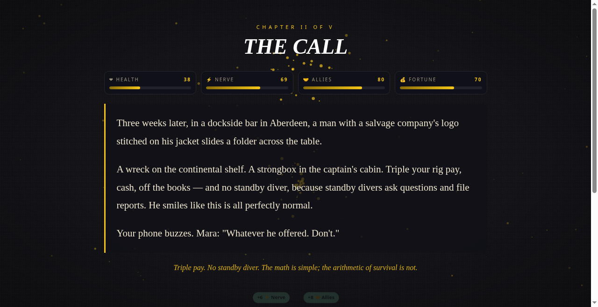

# 🎬 Your Life As: Interactive — VN

**Playable cinematic life stories. Your choices. Multiple endings.**

A branching-narrative browser game that turns the "Your Life As" second-person storytelling format into something you can *live*. Pick a life — deep-sea diver, medieval knight, K-pop idol — and steer it through five cinematic chapters where every choice bends your stats and your fate.

## ✨ Features

- **3 hand-written lives** — *Your Life As a Deep-Sea Diver*, *Your Life As a Medieval Knight*, *Your Life As a K-Pop Idol* — each a complete branching story with real, cinematic second-person prose (zero placeholder text)
- **5-chapter structure** — COLD OPEN → THE CALL → THE DESCENT → THE TURN → EPILOGUE, mirroring the YouTube format
- **Meaningful choices** — every option shifts stats (❤ Health, ⚡ Nerve, 🤝 Allies, 💰 Fortune), sets story flags, or unlocks/locks future paths; some choices require stat thresholds
- **10 distinct endings** — triumphant, bittersweet, and tragic fates per scenario, earned by *your* play, not picked from a list
- **BitLife-style systems** — visible stat bars, random life events between chapters, risk/reward tradeoffs
- **Endings gallery** — collect every fate across lives; progress auto-saves to localStorage with mid-life resume
- **🤖 AI Storyteller (optional)** — when enabled, a free AI narrator (Puter.js — no key, no account, no backend) weaves one-line vignettes from *your actual choices*. The hand-authored story graph is the backbone: the game works fully offline, and every AI line falls back silently to written prose on any failure. The AI never changes plot, stats, or endings.
- **Maximalist VN presentation** — canvas particle VFX, chapter-transition bursts, ending particle rain, film grain + vignette, fully synthesized WebAudio SFX (zero audio files), mobile-friendly

## 🎮 How to play

1. Open `index.html` (or the live GitHub Pages link) — no build, no server, no install
2. Choose a life
3. Read, choose, live with it
4. Reach the EPILOGUE and discover which ending you earned
5. Try the AI Storyteller toggle for AI-woven vignettes

## 🛠 Tech

Vanilla JS, single `index.html`, zero dependencies, zero build step. Saves in `localStorage`. Works from `file://` or any static host.

## 🧪 Tested

- Headless-Chromium playthrough: full Deep-Sea Diver run to the "Legend of the Rigs" ending — stats changed, ending unlocked in gallery, save/resume verified, 44/44 DOM ids resolve, zero console errors
- Knight + Idol smoke runs (3 choices each), 390px mobile overflow check, AI-offline fallback check (blocked network → authored prose, no errors)
- Story-data validation: every choice option carries a consequence (stat change and/or flag), every ending reachable, epilogue catch-alls verified

## 📄 License

MIT — see [LICENSE](LICENSE).

---
**✦ VN ✦** — a Vivek Nair original
